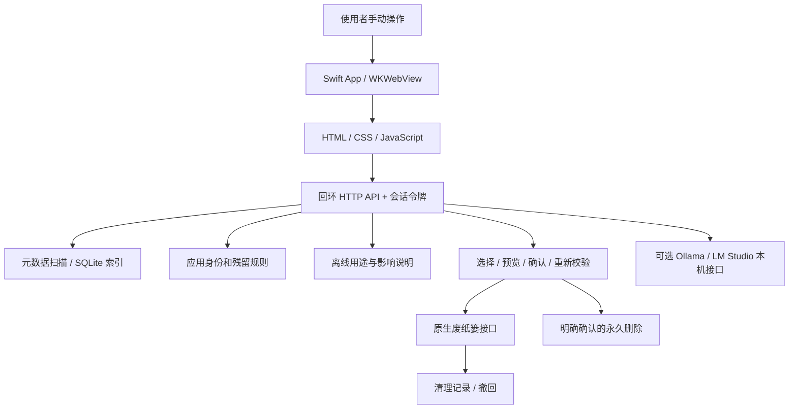

# 架构与数据流

## 组件

App 不依赖外部浏览器，也不需要常驻登录项。源码浏览器调试入口与原生 App 入口独立。

## 扫描和说明

`storage.py` 使用文件元数据构建会话内的 SQLite 索引；`descriptions.py` 根据路径、类型和已安装应用信息生成说明。扫描跳过符号链接及跨设备挂载。

软件列表读取配置的 Applications 根目录。软件卸载页不会自动触发文件全盘扫描，也不会在读取软件列表时搜索残留。

`ApplicationCatalog` 读取公开的应用名称、Bundle ID、版本与相关组件身份。`AppPresentation` 通过系统接口读取 Finder 显示名称和图标，短时间缓存在内存，不启动被识别的软件。

## 文件操作

前端提交会话内项目 ID，后端生成有时效的操作计划。执行前再次检查路径、文件身份、权限、应用运行状态及归属，避免路径改变后继续执行旧计划。

普通清理与软件卸载使用不同的范围校验。软件卸载需确认完整应用名称；同名残留目录需额外确认归属。软件和残留仅允许移入废纸篓，不能通过普通永久删除接口绕过专用确认。

成功移动前先持久化恢复记录；撤回不覆盖目标位置已有的同名内容。永久删除采用独立的操作确认，不能用废纸篓计划代替。

## AI 边界

本地 AI 解释是可选功能。只允许回环 HTTP 地址，不接受远程端点或重定向，不启动、下载或管理模型软件。请求仅包含使用者主动选择项目的元数据、归属依据和离线说明。

模型输出只展示为建议。模型不会获得文件操作权限，也不会自动改变可清理等级、勾选、删除或执行命令。

## 状态与退出

| 数据 | 位置与生命周期 |
| --- | --- |
| 原生 App 扫描索引和会话令牌 | 本机临时目录，本次 App 会话结束后删除 |
| 网页存储 | WKWebView 非持久化会话 |
| 清理记录、应用身份、AI 设置、权限确认 | 当前用户 `~/Library/Application Support/SpaceLens/` |
| 源码调试状态 | 仓库 `.state/`，通过 `.gitignore` 排除 |

关闭时先取消扫描；正在进行的移动、删除或恢复完成后再退出。后端监视原生父进程，父进程结束后退出。独立安装的 Ollama / LM Studio 不由本工具关闭。

程序不宣称擦除 macOS 自己生成的系统日志，也不保证所有第三方应用都没有未知或共享残留。
